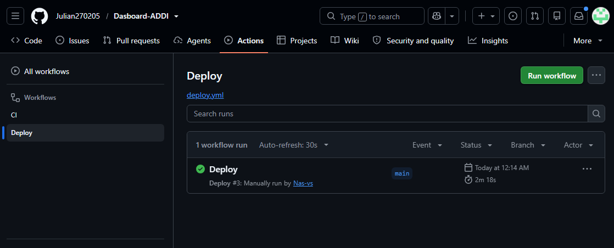

# 3. Desplegar y crear usuarios

## Lanza el despliegue

En el repositorio de código: **Actions → Deploy → Run workflow → rama `main` → Run workflow**.

<figure><figcaption><p>El workflow Deploy terminado en verde.</p></figcaption></figure>

El workflow tiene dos trabajos:

| Trabajo | Qué hace |
| --- | --- |
| **imagenes** | Construye las imágenes de la API y de la interfaz y las publica en GHCR |
| **desplegar** | Entra a la EC2, copia la configuración de Docker, descarga las imágenes, las arranca, aplica las migraciones y carga los datos |

Tarda unos 2 o 3 minutos.


Después de la primera vez no hace falta lanzarlo a mano: **cada merge a `main` despliega solo.**


## Revisa los contenedores

```bash
cd /opt/addi-dashboard
docker compose ps
```

Deben aparecer `web`, `api`, `n8n` y `postgres` con estado **Up**, y postgres **healthy**.


Todos los comandos `docker compose` se corren **dentro de** `/opt/addi-dashboard`. Desde otra carpeta sale `no configuration file provided: not found`.


## Crea los usuarios

Solo la primera vez. Corre cada comando por separado y **guarda las contraseñas temporales** que imprimen; no se vuelven a mostrar.


```bash
docker compose exec api python -m app.cli crear-admin --nombre "Tu nombre" --correo tu@correo.com
```



```bash
docker compose exec api python -m app.cli crear-usuarios-demo
```


* `crear-admin` crea tu usuario administrador. El correo es tu usuario para iniciar sesión.
* `crear-usuarios-demo` crea un aprobador por dominio COBIT y un lector (ver [Roles y permisos](../uso/roles-y-permisos.md)).

## Comprueba el sitio

| Dirección | Debe |
| --- | --- |
| `https://addi-ti.duckdns.org/api/v1/salud` | Responder ok |
| `https://addi-ti.duckdns.org` | Mostrar el login con el candado de HTTPS |

Entra como admin y cambia tu contraseña en **Cuenta**.

<details>

<summary>El candado no aparece o el sitio no carga</summary>

Caddy puede tardar uno o dos minutos en sacar el certificado. Revisa:

```bash
docker compose logs --tail=30 web
```

* `certificate obtained successfully`: listo, recarga la página.
* `Timeout during connect`: DuckDNS apunta a otra IP o el puerto 80/443 está cerrado. Corrígelo y luego:

```bash
docker compose restart web
```

</details>
