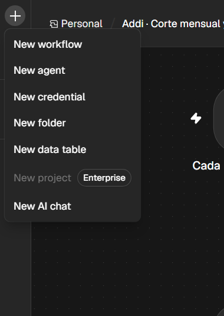
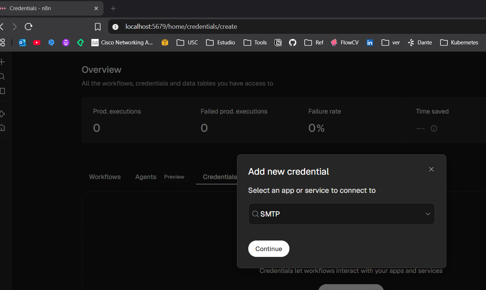
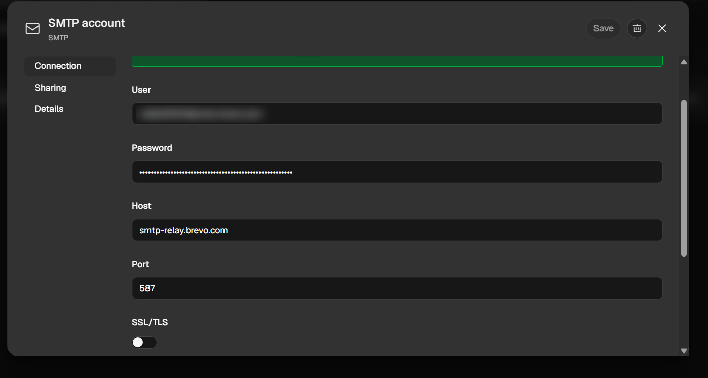
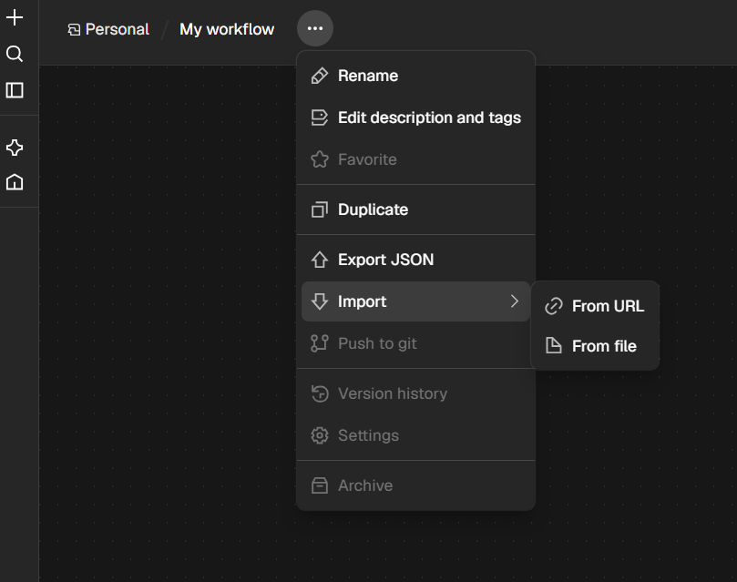
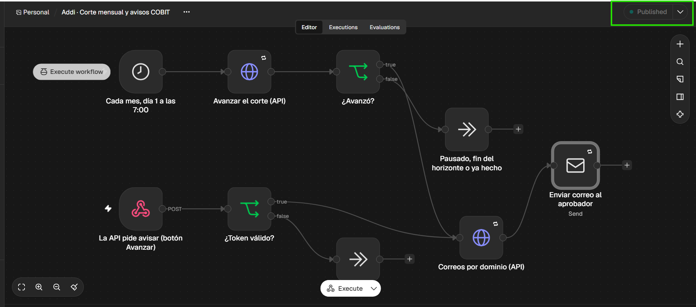

# 4. n8n y correo con Brevo

Por seguridad, el editor de n8n **no está publicado en internet**. Se entra con un **túnel SSH**: una conexión cifrada que lleva un puerto del servidor a tu computador.

## Prepara la cuenta de Brevo

Brevo es el servicio que envía los correos (gratis hasta 300 al día).



### Crea la cuenta

En [brevo.com](https://www.brevo.com), con el correo del equipo. Completa el perfil; sin él, Brevo puede bloquear el envío.



### Verifica el remitente

**Senders, Domains & Dedicated IPs → Senders → Add sender**. Ingresa el correo y el código que te llega. Debe ser el mismo de `CORREO_REMITENTE` en el `.env`.



### Genera la clave SMTP

**SMTP & API → SMTP → Generate a new SMTP key**. Guarda el **Login** (termina en `@smtp-brevo.com`) y la **SMTP key**. La clave solo se muestra una vez.




**¿Por qué no Hotmail u Outlook directo?** Desde 2024 las cuentas personales de Outlook y Hotmail no aceptan usuario y contraseña por SMTP, y el nodo de correo de n8n necesita eso. Brevo resuelve el envío. Como el remitente es un correo gratuito, algunos correos pueden llegar a **spam**; pide marcarlos como "No es spam".


## Abre el túnel

En tu terminal (déjala abierta mientras trabajas en n8n):

```bash
ssh -i ~/.ssh/addi-ti.pem -L 5679:localhost:5678 ubuntu@<IP>
```

Abre en el navegador **http://localhost:5679**. La primera vez, n8n pide crear una cuenta de dueño; es solo para entrar al editor.


Usamos el puerto **5679** para no confundirlo con un n8n que tengas corriendo en local en el 5678.


## Crea la credencial de correo

En el botón **+** del panel izquierdo, elige **New credential**, busca **SMTP** y pulsa **Continue**.

<div><figure><figcaption></figcaption></figure> <figure><figcaption></figcaption></figure></div>

| Campo | Valor |
| --- | --- |
| User | El **Login** SMTP de Brevo |
| Password | La **SMTP key** de Brevo |
| Host | `smtp-relay.brevo.com` |
| Port | `587` |
| SSL/TLS | **Desactivado** (en el 587 la conexión se cifra con STARTTLS, que n8n activa solo) |

<figure><figcaption><p>Al guardar, n8n prueba la conexión. Si sale en verde, quedó bien.</p></figcaption></figure>

## Importa y publica el flujo



### Descarga el flujo

```bash
curl -fsSLO https://raw.githubusercontent.com/Julian270205/Dasboard-ADDI/main/n8n/corte_y_avisos_cobit.json
```



### Impórtalo

**+ → New workflow**. En los tres puntos (**…**) de arriba: **Import → From file**.

<figure><figcaption></figcaption></figure>



### Conecta el correo

Doble clic en el nodo **Enviar correo al aprobador** → en *Credential* elige la credencial SMTP.



### Publica

Guarda y pulsa **Publish**. Debe quedar como **Published**.

<figure><figcaption></figcaption></figure>



## Qué hace el flujo

| Entrada | Cuándo | Qué hace |
| --- | --- | --- |
| **Cada mes, día 1 a las 7:00** | Cron (hora de Bogotá) | Pide a la API avanzar el corte; si avanzó, pide los correos por dominio y los envía |
| **La API pide avisar** | Cuando el admin pulsa *Avanzar un mes* | Verifica el token interno, pide los correos y los envía |

n8n **no tiene credenciales de la base de datos**. La API arma cada correo (destinatarios, copia al CTO, botones) y n8n solo lo envía.

## Prueba final

1. En el tablero, como admin, la franja superior debe decir **n8n conectado, flujo activo** con un punto verde.
2. En **Administración → Usuarios**, cambia el correo de un aprobador por uno real tuyo.
3. Pulsa **Avanzar un mes**.
4. Revisa la bandeja de entrada **y la de spam**.

Si no llega, revisa en Brevo **Transactional → Logs** y en n8n la pestaña **Executions**.
