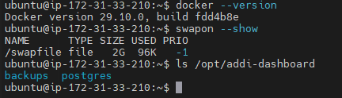

# 1. Preparar el servidor

## Apunta el dominio al servidor



### Anota la IP pública

En la consola de AWS, en la instancia (o en la Elastic IP asociada).



### Actualiza DuckDNS

En [duckdns.org](https://www.duckdns.org), en el subdominio `addi-ti`, pon esa IP en **current ip** y pulsa **update ip**.



### Comprueba

Desde tu terminal:

```bash
nslookup addi-ti.duckdns.org
```

Debe responder con la IP de la instancia. Puede tardar uno o dos minutos.




Si DuckDNS tiene una IP vieja, el sitio no carga y Caddy no puede sacar el certificado HTTPS. **Es el error más común.** Cada vez que cambies de instancia, actualiza DuckDNS y el secreto `EC2_HOST`.


## Instala lo necesario

Guarda la llave en tu carpeta `~/.ssh/` y protégela. SSH rechaza llaves con permisos abiertos o guardadas en `/mnt/c/…`.

```bash
cp /ruta/a/tu-llave.pem ~/.ssh/addi-ti.pem
chmod 400 ~/.ssh/addi-ti.pem
ssh -i ~/.ssh/addi-ti.pem ubuntu@<IP>
```

Ya dentro del servidor:


```bash
curl -fsSLO https://raw.githubusercontent.com/Julian270205/Dasboard-ADDI/main/infra/scripts/setup-ec2.sh
sudo bash setup-ec2.sh
exit
```


El script hace cuatro cosas:

1. Crea **2 GB de swap**, porque la instancia solo tiene 1 GB de RAM.
2. Instala **Docker**.
3. Crea la carpeta de la aplicación, `/opt/addi-dashboard`.
4. Programa un **respaldo diario** de la base de datos a las 3:30 a. m.


El `exit` es necesario: hay que salir y volver a entrar para que tu usuario pueda usar Docker sin `sudo`.


## Verifica

Vuelve a entrar con el mismo `ssh` y corre:

```bash
docker --version
swapon --show          # debe mostrar /swapfile 2G
ls /opt/addi-dashboard
```

<figure><figcaption><p>Docker instalado, swap de 2 GB activa y carpeta creada.</p></figcaption></figure>

Por último, dale a tu usuario permiso sobre la carpeta. Sin esto, el siguiente paso falla con `Permission denied`:

```bash
sudo chown -R $USER:$USER /opt/addi-dashboard
```
