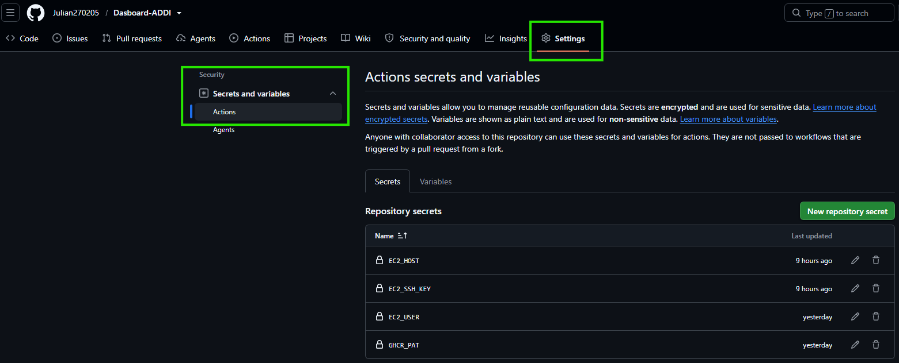
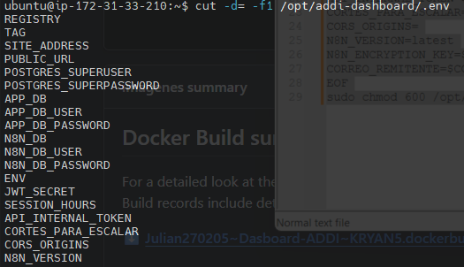
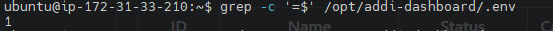
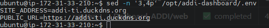

# 2. Secretos y archivo .env

## Secretos en GitHub

El workflow de despliegue necesita saber a qué servidor entrar y con qué llave. Esos datos se guardan **cifrados** como secretos del repositorio.

En el repositorio de código: **Settings → Secrets and variables → Actions → New repository secret**.

<figure><figcaption><p>Los cuatro secretos del despliegue.</p></figcaption></figure>

| Secreto | Valor |
| --- | --- |
| `EC2_HOST` | La IP pública del servidor (la misma de DuckDNS) |
| `EC2_USER` | `ubuntu` |
| `EC2_SSH_KEY` | Todo el contenido del archivo `.pem`, incluidas las líneas `-----BEGIN…` y `-----END…` |
| `GHCR_PAT` | Token de GitHub con permiso `read:packages`, para que el servidor descargue las imágenes |

<details>

<summary>Cómo crear el GHCR_PAT</summary>

1. En GitHub, tu foto → **Settings → Developer settings → Personal access tokens → Tokens (classic)**.
2. **Generate new token (classic)**.
3. Marca solo `read:packages` y elige una fecha de vencimiento.
4. Copia el token y pégalo como secreto `GHCR_PAT`. Solo se muestra una vez.

</details>

## El archivo .env del servidor

El `.env` guarda la configuración del servidor: el dominio, el correo remitente y las contraseñas internas. **Solo vive en el servidor y nunca se sube a GitHub.**

Pega el bloque completo **directamente en la terminal** del servidor. Cambia antes las dos primeras líneas:

* `DOMINIO`: el subdominio de DuckDNS.
* `CORREO`: el correo **verificado como remitente en Brevo** (no el *Login* SMTP de Brevo).


```bash
DOMINIO=addi-ti.duckdns.org
CORREO=remitente-verificado@ejemplo.com
s() { openssl rand -base64 32 | tr -d '/+=' ; }
cat > /opt/addi-dashboard/.env <<EOF
REGISTRY=ghcr.io/julian270205/dasboard-addi
TAG=latest
SITE_ADDRESS=$DOMINIO
PUBLIC_URL=https://$DOMINIO
POSTGRES_SUPERUSER=postgres
POSTGRES_SUPERPASSWORD=$(s)
APP_DB=addi
APP_DB_USER=addi_api
APP_DB_PASSWORD=$(s)
N8N_DB=n8n
N8N_DB_USER=n8n
N8N_DB_PASSWORD=$(s)
ENV=produccion
JWT_SECRET=$(s)
SESSION_HOURS=8
API_INTERNAL_TOKEN=$(s)
CORTES_PARA_ESCALAR=2
CORS_ORIGINS=
N8N_VERSION=latest
N8N_ENCRYPTION_KEY=$(s)
CORREO_REMITENTE=$CORREO
EOF
chmod 600 /opt/addi-dashboard/.env
```


**¿Qué hace este bloque?** La línea `s() {…}` define un comando que genera una contraseña aleatoria. Cada `$(s)` se reemplaza por una contraseña distinta, así nadie tiene que inventarlas. `chmod 600` deja el archivo legible solo para tu usuario.


**No lo pegues dentro de `nano` u otro editor.** Si el archivo termina con el texto del script, el despliegue falla con `unexpected character "("`.



**Créalo una sola vez**, antes del primer despliegue. Si lo regeneras después, cambian las contraseñas y PostgreSQL deja de aceptar a la API y a n8n. Para cambiar un solo valor, edita esa línea:

```bash
sed -i "s|^CORREO_REMITENTE=.*|CORREO_REMITENTE=nuevo@correo.com|" /opt/addi-dashboard/.env
```


## Verifica sin mostrar las contraseñas



```bash
cut -d= -f1 /opt/addi-dashboard/.env
```

Solo deben aparecer nombres de variables, sin líneas como `s()` ni `cat`.

<figure><figcaption></figcaption></figure>



```bash
grep -c '=$' /opt/addi-dashboard/.env
```

Debe dar **1**: solo `CORS_ORIGINS` va vacía.

<figure><figcaption></figcaption></figure>



```bash
sed -n '3,4p' /opt/addi-dashboard/.env
```

Debe mostrar tu dominio real.

<figure><figcaption></figcaption></figure>



Todas las variables están explicadas en [Variables del .env](../referencia/variables-env.md).
